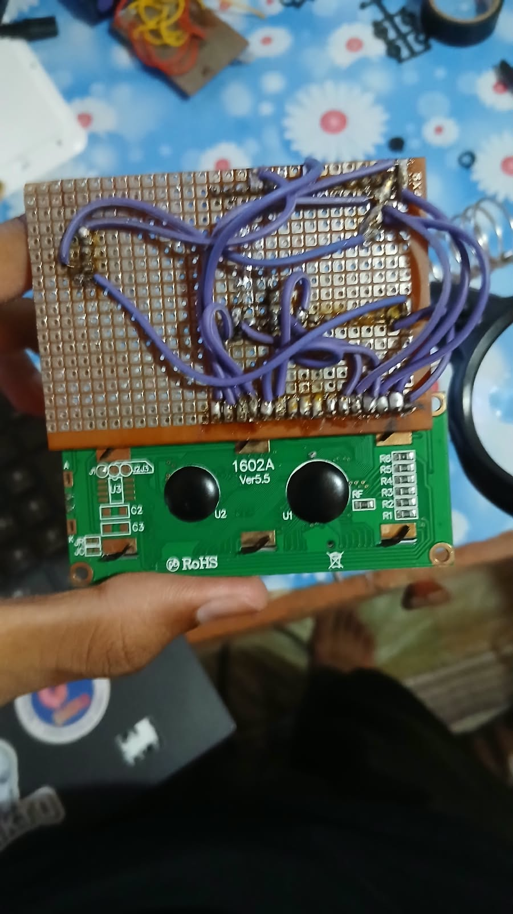

# 🌱 Automatic Water Irrigation System

An ESP32-based smart irrigation system designed to monitor soil moisture and automatically control a water pump according to the moisture level of the soil.

The system creates its own Wi-Fi Access Point and provides a web-based dashboard for real-time monitoring and manual pump control. It can operate independently without requiring an internet connection.

## 🚀 Features

- **Automatic Irrigation:** Automatically starts and stops watering based on soil moisture.
- **Wi-Fi Access Point:** ESP32 creates its own Wi-Fi network.
- **Web Dashboard:** Monitor soil moisture and pump status through a web browser.
- **Manual Pump Control:** Turn the water pump ON or OFF through the dashboard.
- **Dual Operating Modes:** Switch between Automatic and Manual modes.
- **LCD Display:** Displays soil moisture, pump status and operating mode.
- **Real-time Monitoring:** Dashboard refreshes sensor readings automatically.

## 🛠️ Components Required

| Component | Quantity |
|---|---:|
| ESP32 Development Board | 1 |
| Soil Moisture Sensor | 1 |
| 16×2 LCD Display | 1 |
| Relay Module | 1 |
| DC Water Pump | 1 |
| External Pump Power Supply | 1 |
| Jumper Wires | As required |

## 🔌 Circuit Connections

### 1. Soil Moisture Sensor

| Sensor Pin | ESP32 Pin |
|---|---|
| VCC | 3.3V |
| GND | GND |
| AO | GPIO 34 |

### 2. 16×2 LCD Display (4-bit Mode)

The LCD uses parallel communication in 4-bit mode.

| LCD Pin | ESP32 Connection |
|---|---|
| VSS | GND |
| VDD | 5V |
| V0 | GND (basic contrast connection) |
| RS | GPIO 21 |
| RW | GND |
| E | GPIO 22 |
| D4 | GPIO 18 |
| D5 | GPIO 19 |
| D6 | GPIO 23 |
| D7 | GPIO 25 |
| LED+ | 5V (check backlight resistor) |
| LED- | GND |

LCD data pins D0–D3 are not connected.

### 3. Relay Module

| Relay Pin | ESP32 Connection |
|---|---|
| VCC | 5V (for a 5V relay module) |
| GND | GND |
| IN | GPIO 26 |

### 4. Water Pump

The water pump is controlled through the relay module.

- COM → Positive terminal of pump power supply.
- NO → Positive terminal of water pump.
- Negative terminal of pump → Negative terminal of pump power supply.

Use an external power supply suitable for the pump.

## 📷 PCB Design

### PCB Back Side



## ⚙️ Working Principle

The soil moisture sensor measures the moisture content of the soil and sends an analog signal to the ESP32.

The ESP32 reads the analog value through GPIO 34 and converts it into an approximate moisture percentage.

Based on the calculated moisture level, the system controls the water pump automatically.

### Automatic Irrigation Logic

| Soil Moisture | Pump Action |
|---|---|
| 0–30% | Pump ON |
| 30–45% | Maintains previous state |
| 45–100% | Pump OFF |

The system uses hysteresis to prevent the relay from switching rapidly when the soil moisture is close to the threshold.

## 🌐 Web Dashboard

The ESP32 operates in Access Point mode and hosts a web server.

### Wi-Fi Configuration

| Setting | Value |
|---|---|
| Wi-Fi SSID | Smart_Irrigation |
| Password | Water123 |
| IP Address | 192.168.4.1 |
| Dashboard URL | http://192.168.4.1 |

### How to Access the Dashboard

1. Power on the ESP32.
2. Connect your phone or computer to `Smart_Irrigation`.
3. Open your web browser.
4. Enter `http://192.168.4.1`.
5. The irrigation dashboard will appear.

### Dashboard Functions

- View live soil moisture percentage.
- View raw analog sensor readings.
- Check water pump status.
- Switch between Automatic and Manual modes.
- Manually turn the water pump ON or OFF.

The dashboard automatically refreshes the readings every 1.5 seconds.

## 🔄 Operating Modes

### Automatic Mode

The ESP32 continuously monitors soil moisture and controls the pump according to the predefined thresholds.

### Manual Mode

The user can control the water pump directly through the web dashboard, regardless of the soil moisture reading.

## 💻 Software Requirements

- Arduino IDE
- ESP32 Board Package
- LiquidCrystal Library

## 📂 Project Structure

```text
Automatic-Water-Irrigation/
│
├── automatic_water_irrigation_esp32.ino
├── README.md
│
└── circuit/
    ├── circuit_diagram.png
    └── pcb_back.jpeg
```

## ⚠️ Important Notes

- Calibrate the soil moisture sensor before using the system.
- The sensor's analog output must remain within the ESP32's permitted input voltage.
- Never connect the water pump directly to an ESP32 GPIO.
- Use a suitable external power supply for the pump.
- Check whether the relay module is active HIGH or active LOW.
- Ensure appropriate grounding and electrical isolation.
- Keep electronic components protected from water.

## 🔮 Future Improvements

- Water tank level monitoring.
- Multiple soil moisture sensors.
- Historical moisture data and graphs.
- Remote monitoring through the internet.
- Solar-powered irrigation system.
- Mobile application integration.

## 👨‍💻 Author

Developed as an ESP32-based smart agriculture and automation project.

**Project:** Automatic Water Irrigation System  
**Microcontroller:** ESP32  
**Programming Language:** C++ (Arduino)

---

⭐ If you find this project interesting, consider giving the repository a star!
